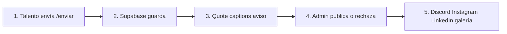
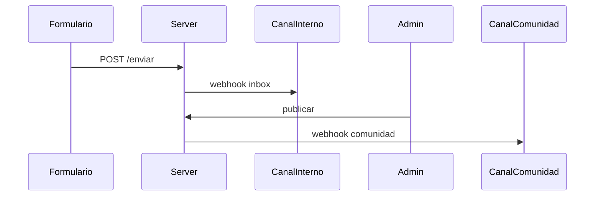
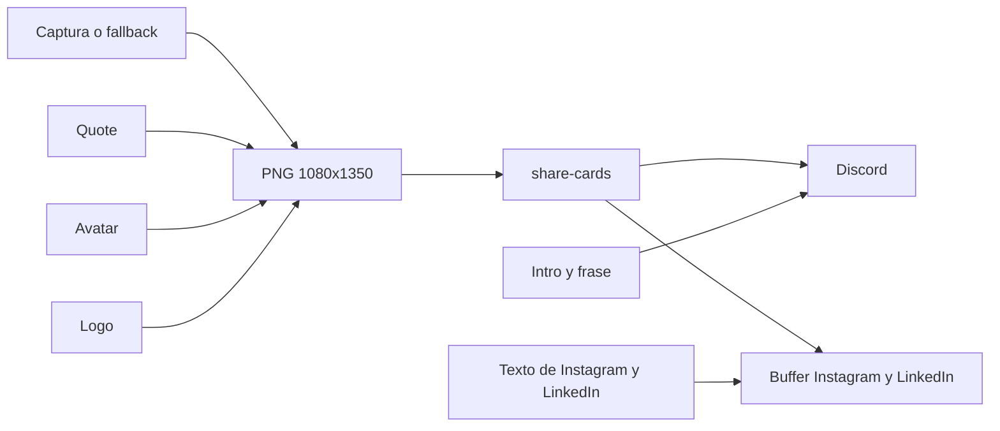

# Plan: sistema de testimonios

El inbox ya no vive en esta app. Galería y `/enviar` quedan en `apps/testimonios`. Revisar y publicar está en `apps/panel-admin` (`/testimonials`). Quote y captions salen de la plantilla; no hay generación con IA.

Brief: capturar → almacenar → validar → compartir (Discord, Instagram y LinkedIn). Tally/Excel son referencia de campos. Formato base: **texto**. **Avatar obligatorio**. Foto testimonial y YouTube opcionales. Se pide en **Demo Day**.

App nueva `apps/testimonios` (Next + Supabase). No se mezcla con la landing de empresas.

---

# V1 — Cómo funciona el sistema




El talento no entra al admin. El equipo **solo valida y publica**. El resto corre solo.

**V1 no procesa video.** Si hay video, es un **link de YouTube**: se guarda y se embebe. Sin grabar en el form, sin subir mp4, sin FFmpeg, sin worker, sin OpenCut.

## Cuándo se pide — Demo Day

El pedido y el recordatorio se dicen **en la Meet del demo day**. El mismo día, además, un aviso en el **canal general de Discord**.

1. **Inicio de la Meet.** Speech corto + link `/enviar` en el chat.
2. **Mismo día, Discord general.** Un mensaje en el canal general con el mismo link, para quien no está en la Meet o entra tarde.
3. **Cierre de la Meet.** Recordatorio + el mismo link otra vez en el chat.

Cadencia: cada simulación / al menos un lote al mes.

## Capturar — `/enviar`

Wizard corto, sin login.

1. Qué querés contar
2. Nombre, país, email y foto de perfil
3. Historia según el tipo
4. Foto testimonial (opcional) + YouTube, Instagram y LinkedIn (opcionales)
5. Consentimiento y enviar

**Todos**

- Qué querés contar — obligatorio
- Nombre completo — obligatorio
- País — obligatorio en el form. En DB puede ser null (envíos anteriores). Se muestra junto al nombre en `/t/[slug]` y en la card de las redes
- Email — obligatorio (no sale en público)
- **Avatar** — **obligatorio**. Foto de la **persona** (cara / perfil). Va redondo en la card y en Discord junto al nombre. Sin avatar no se puede enviar.
- **Foto testimonial** — opcional. **No es el avatar.** Foto del **entorno de trabajo** (equipo, oficina, reunión), no una captura del proyecto. Es la foto de arriba de la card (diseño Foto arriba); si no hay, se usa `public/brand/ig-fallback.jpg`
- Video — opcional: **solo URL de YouTube**
- Instagram — opcional, para mención en el caption de IG
- LinkedIn — opcional, perfil (`linkedin.com/in/…`) o handle, para el caption de LI
- Consentimiento — obligatorio

**Según el tipo**

- Simulación: puesto principal (opcional) + *Contanos tu experiencia en la simulación*
- Primer empleo: empresa, puesto, *Cómo te ayudó la simulación*
- Reconversión: oficio anterior, rol nuevo, *Por qué cambiaste y cómo te está ayudando No Country*

Totales: simulación 7 obligatorios (incluye país y avatar); empleo y reconversión 9.

Al enviar, el sistema arma los textos **sin IA**: recorta lo que escribió la persona.

- **Quote** (la frase de la card): primeras ~200–240 caracteres o las primeras 2 oraciones, cortando en un punto o espacio.
- **Captions** de Instagram y LinkedIn (misma plantilla, distinta red). El formulario guarda los dos. El panel publica un solo texto para Instagram y LinkedIn; Discord lleva la intro y la frase (ver abajo):

```
Desde No Country compartimos esta historia de nuestro talento

"{quote}"

{fullName}
{instagram | linkedin}

#NoCountry #DemoDay #TalentoIT
```

En el panel (`/testimonials/[id]`) hay un solo **Texto del post** para Instagram y LinkedIn. Parte de `ig_caption`; si sigue la plantilla, lleva el Instagram y el LinkedIn de la persona (los que haya). Al guardar o publicar se escribe en `ig_caption` y se copia a `li_caption`. Discord no usa ese texto: lleva la intro y la frase. Si el texto sigue la plantilla y cambia el quote, se rearma con el mismo intro. Quote, nombre, redes y hashtags los arma el código. Detalle: [COPY_PIPELINE.md](./COPY_PIPELINE.md).

## Guardar

Supabase: una fila (`in_review`). Avatar obligatorio y captura opcional en Storage. `video_url` = YouTube. Email solo admin.

Tablas, enums y SQL: [app_testimonios_v1_db.md](app_testimonios_v1_db.md).

## Validar — panel (`/testimonials`)

Revisar y publicar está en `apps/panel-admin`, en `/testimonials` y `/testimonials/[id]`, dentro del mismo shell que el resto del panel. No hay login propio ni generación con IA: el quote y los captions salen de la plantilla y se editan a mano.

Inbox master-detail (`InboxShell`): lista a la izquierda, ficha a la derecha. Los filtros viven en la URL: `?status=` (`in_review`, `published`, `rejected`), `?type=` (`simulation`, `first_job`, `career_change`) y `?s=` (hasta 100 caracteres, sin caracteres de control). Un valor inválido redirige a la query válida. La lista aplica esos filtros en memoria. Al elegir un envío, el detalle muestra un esqueleto (`DetailLoading` / `[id]/loading.tsx`) hasta que carga `/testimonials/[id]`.

En la ficha (`ReviewForm`): envío original arriba (desplegable) y una sola **Publicación** para las tres redes. A la izquierda, el diseño de la card y la preview 1080×1350; a la derecha, la **Frase de la imagen** (quote) y el **Texto del post**, los dos editables. Arriba se ve a qué redes sale (`ShareTargets`). Publicar, guardar borrador o rechazar.

Después de publicar, la ficha (`PublishedPanel`) muestra el estado por red, la card que salió y los botones para descargarla y copiar el texto. Si alguna red falla, un solo botón reintenta las que falten.

## Publicar en Discord de comunidad (post validación)

No hay bot, ni OAuth, ni Discord Developer Portal. Son **dos Incoming Webhooks** (una URL por canal). En Discord: Editar canal → Integraciones → Webhooks → Nuevo webhook. Cada URL va a un env distinto. El de comunidad **no dispara** hasta que un admin publica.




**Setup**

No hace falta ser dueño ni “Admin” del servidor. Hace falta el permiso **Manage Webhooks** en ese canal (o que un admin te cree el webhook y te pase la URL).

1. Canal interno del equipo (privado): crear webhook → `DISCORD_INBOX_WEBHOOK_URL`.
2. Canal de comunidad (el de testimonios, no el general del Demo Day): crear webhook → `DISCORD_COMMUNITY_WEBHOOK_URL`.
3. Pegar las URLs en `.env.local` / Vercel. Si una está vacía, ese aviso no se manda; el resto de la app sigue.

El aviso del Demo Day en el canal **general** es a mano (link `/enviar`). Los webhooks son otro canal: inbox del equipo y publicación a la comunidad.

**Al enviar** (aún `in_review`): `POST` JSON al webhook interno. Aviso corto: nombre, tipo, “nuevo testimonio”, link a `{ADMIN_PANEL_URL}/testimonials/{id}`. Username del webhook: algo tipo “Testimonios inbox”. La comunidad no ve nada.

**Al publicar:** el server action pasa la fila de `in_review` a `published` y escribe `published_at`. Solo sigue el request que cambia la fila. Ese sube el PNG a `share-cards`. Si el PNG no se genera, pasa de 5 MB o no llega, no se publica. Si Storage falla, la fila vuelve a `in_review` con `published_at` en null. Con la card guardada reserva cada red (la fecha solo si sigue en null) y **después** postea Discord (webhook) e Instagram/LinkedIn (Buffer). Si la llamada falla, borra esa fecha. El testimonio no espera a las redes para quedar publicado.

Cuerpo del `POST` (comunidad): solo `embeds[0]` (sin `content`). Username del webhook: No Country. `avatar_url` de la raíz: logo de No Country.

Cuerpo del post (embed), en `postCommunityTestimonial`:

- Autor: `full_name` + avatar. El archivo **no se sube a Discord**. Se manda `embeds[0].author.icon_url` con la URL pública de Storage del avatar. Discord la descarga.
- Descripción: la intro y la frase entre comillas. No es el texto de Instagram y LinkedIn.
- Imagen grande: la **card** de `share-cards` (la misma que Instagram y LinkedIn).
- Si hay YouTube, un campo **Video** con el link `watch?v=` (un embed no reproduce YouTube).
- Color: magenta de No Country. Sin título ni footer.

Si el webhook falla, el testimonio **igual queda publicado** (`published_at`). `discord_posted_at` queda null. La ficha muestra Falló y un solo botón reintenta las redes que falten. Si el POST sale bien, se escribe `discord_posted_at`. El webhook no devuelve la URL del mensaje: Discord no tiene **Ver post**.

### Cómo se usa cada media (sin galería)

Tabla por red: [MEDIA_FORMATS.md](./MEDIA_FORMATS.md). Las tres redes reciben **la misma card**. Instagram y LinkedIn comparten el texto; Discord lleva la intro y la frase. Solo cambia cómo va el video.

- **Avatar** (cara / perfil, siempre hay): va en la **card generada**. En Discord, además, es el icono junto al nombre.
- **Foto testimonial** (entorno de trabajo, opcional): es la foto de arriba de la card (si no hay, fallback de marca). No se postea cruda en ninguna red.
- **YouTube** (URL, no un mp4 nuestro, opcional): en Discord va en un campo **Video** del embed; en LinkedIn se suma al final del texto (`Video: watch?v=…`). En Instagram no entra (no admite links en el caption y un Reel pide archivo). El Reel queda para v2.

**Discord, en la práctica**

1. Siempre: nombre + avatar chico + intro y frase + la card de imagen grande.
2. Si hay YouTube: el link `watch?v=` va en un campo del embed. Un embed **no** reproduce YouTube; el link queda clickeable. No se manda `content` aparte.
3. No se sube el video como archivo. No hace falta.

**La card (las tres redes)**

Instagram no acepta un post de solo texto, así que el post es **una imagen 4:5 (1080×1350) + un texto**, y esa misma imagen sale en Discord y LinkedIn. La imagen **se genera** en el panel: no se postea la captura ni el avatar crudos.

La card se dibuja en el browser (`drawIgCard` sobre un `<canvas>` en `apps/panel-admin`) y se exporta a PNG con `igCardPngBlob`. La foto de arriba es la captura que subió la persona; si no hay, `public/brand/ig-fallback.jpg` del panel. Tope del PNG: 5 MB (`SHARE_CARD_MAX_BYTES`), el mismo corte del bucket `share-cards`.

**Logo:** el chrome y la card usan el mismo PNG (`public/brand/logo-no-country.png`). El header usa [`BrandLogo`](../../../packages/ui/docs/brand-logo.md) (`@repo/ui`); el PNG es el default del componente. No hay SVG en esta app.

El admin elige el diseño en la ficha (**Diseño de la imagen**). **Foto arriba** es el base de todos los tipos; los otros dos son propios de cada tipo:

- Simulación: Foto arriba, Cita (sin foto, la frase grande) y Retrato (la persona al centro)
- Primer empleo: Foto arriba, Empresa (la empresa que lo contrató en grande) y Recorrido (de la simulación al puesto)
- Reconversión: Foto arriba, Antes y ahora (oficio anterior → rol nuevo) y Perfil (tarjeta con la foto de portada)

El diseño elegido no se guarda: la card publicada queda en `share-cards/{slug}/instagram.png` y es la que se descarga después. Los handles van en el texto, no en la card.



**LinkedIn, en la práctica (v1)**

Buffer publica la card. Instagram y LinkedIn usan **el mismo texto**: si la persona tiene las dos redes, van las dos. Si hay YouTube, el link se suma al final en LinkedIn. En la base, `li_caption` guarda una copia de `ig_caption`.

La app pública arma un texto por red (`buildIgCaption` y `buildLiCaption`), cada uno con su handle. En el panel se deja un solo texto a propósito: es la misma publicación y el admin lo edita una vez.

**Cómo se publica**

1. En revisión (`/testimonials/[id]`): elegir el diseño, retocar la frase y el texto. Publicar.
2. Al publicar: el update a `published` gana solo si la fila sigue `in_review`. El que gana sube el PNG a `share-cards`. Si el PNG no se genera, pasa de 5 MB o no llega, no se publica y el panel muestra **Reintentar imagen**. Si Storage falla, la fila vuelve a `in_review`. Después reserva cada red y postea: Discord (webhook, intro y frase), Instagram (Buffer: card + texto) y LinkedIn (Buffer: card + texto + YouTube). `BUFFER_ENV=production` publica ya (`shareNow`); `development` o si falta programa a 1 semana.
3. Si Discord o Buffer fallan, el testimonio **igual queda en la galería**. La ficha reintenta las redes sin fecha, y las de Buffer cuyo estado es `error`, con un solo botón. Si Buffer creó el post y después informa error, ese reintento borra fecha e id solo si siguen siendo los de ese post. También se puede descargar la card y copiar el texto para subirlo a mano.
4. Se guarda el id de cada post de Buffer (`buffer_*_post_id`). Al abrir la ficha publicada, el panel consulta el estado real en Buffer y, si ya salió, muestra **Ver post** con el link.
5. Sin `BUFFER_API_KEY` o sin channel ID, esa red se saltea.

**Lo que no se puede en v1**

- Pasar el YouTube a un Reel o a un mp4 con logo (hace falta bajar/procesar el archivo → v2).
- Que Discord “incruste” el video dentro de la imagen del embed.
- Postear la captura cruda en Instagram (la imagen del feed es la card, que ya la usa como foto de arriba).

## Stack v1

- Next 16 en `apps/testimonios`, puerto 3001: galería, `/enviar` y `/t/[slug]`
- Inbox en `apps/panel-admin`, puerto 3002: `/testimonials` y `/testimonials/[id]`. Sin login propio
- Supabase: Postgres, Storage (`avatars` + `captures` + `share-cards`), RLS. Escrituras con `service_role`
- Vercel. Sin worker de video
- Env de testimonios: Supabase, `DISCORD_INBOX_WEBHOOK_URL`, `ADMIN_PANEL_URL`
- Env del panel: service role, `DISCORD_COMMUNITY_WEBHOOK_URL`, Buffer (`BUFFER_ENV`, `BUFFER_API_KEY` + channel IDs)

## Orden de implementación (v1)

1. Scaffold de la app
2. Supabase (tabla, Storage avatares + capturas, RLS)
3. Formulario + quote/captions auto (IG + LI) + aviso inbox
4. Admin validar / publicar
5. Galería + embed YouTube
6. Discord webhooks + Buffer (IG/LI) + card única para las tres redes

---

# V2 — Video: qué métodos hay y cuál elegir

Objetivo de v2: marca, portada y formato (Reels 9:16 / Discord 16:9), como pedía el brief. En v1 no se construye. Se **evalúa** qué está disponible entonces y qué encaja (costo, ops, calidad, abandono del form).

## Candidatos a comparar

- **Grabar en el form** (30–60 s, como Senja) — genera archivo nuestro
- **Subir mp4** — mismo archivo, más abandono que grabar
- **Seguir solo YouTube** — embeber, sin marca automática
- **Job FFmpeg** (worker Fly/Railway o API tipo FFmpeg Micro) — logo + tamaños; hace falta archivo, no un link
- **OpenCut** — editor a mano hoy; API / headless del rewrite [aún no está para producción](https://github.com/OpenCut-app/OpenCut/issues/811)

Criterio: el que permita automatizar marca **sin** un servidor caro, y sin alargar tanto el form que lo abandonen. Si OpenCut headless ya existe en ese momento, se compara contra FFmpeg. Hasta entonces v1 no depende de ninguno.