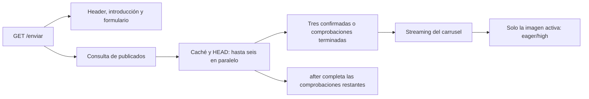

# Primera visita del carrusel

Iteración del 11/11/2026 en `feat/testimonios-carousel-optimized-images`, después del commit intermedio de imágenes/disponibilidad. Arquitectura de streaming aprobada como base por el desarrollador. Las mediciones siguientes conservan el estado de esa etapa (calidad 75 y transcripción inferior); la [iteración visual posterior](./carousel-legibility.md) documenta calidad 85 y carrusel compacto, sin rediseñar carga/caché. Esta etapa no cambió resoluciones, `sizes`, diseño de publicaciones, enlaces, formulario, consentimiento, backend, panel, Storage ni publicación de rutas.

## Diagnóstico

La selección anterior esperaba hasta 200ms y devolvía objetos con `imageUrl: null` si no había positivos. `after()` calentaba el servidor pero **no actualizaba esa página**: una imagen válida podía quedar reemplazada por texto durante toda la primera visita. Cambiar únicamente el plazo desplaza el problema y mantiene la consulta pública/verificación delante de todo el HTML.

Se revisaron el código, Next 16.3 instalado y sus guías de Server/Client Components, fetching/streaming, Image, `unstable_cache` y `after`. No había una espera artificial de React para pintar la imagen: su CSS no depende de `status === loaded` para darle opacidad. `onLoad` oculta el mensaje después de la decodificación; no autoriza la pintura del bitmap.

## Medición real de 200 / 350 / 500ms

Build de producción local, Chrome 157. Para cada alternativa: tres ejecuciones normales 1440px/DPR1 y una 375px/DPR2 con CDP configurado a 1,6Mbps/150ms y CPU×4, cada una fría/caliente. Solo la consulta pública existente y URLs públicas; diez candidatos en la muestra. No hubo POST, uploads, listados de bucket ni lecturas de credenciales.

La caché fría de **disponibilidad** se aisló mediante namespaces temporales de diagnóstico, sin cambiar URLs de Storage. El navegador usó perfiles nuevos en cada pareja. El optimizador de imágenes conservó su propia caché: no es una comparación de todos los caches fríos ni una prueba causal del rendimiento de un encoder. Las variables temporales de presupuesto/namespace se retiraron del código final y no se crearon `.env`.

Medianas de las tres ejecuciones normales con disponibilidad fría:

| Selección | Consulta pública | TTFB | Imágenes confirmadas en respuesta, por ejecución | Primera pintura de imagen |
| --- | ---: | ---: | --- | ---: |
| 200ms | 863ms | 1241ms | 0 / 0 / 0 | No aparece sin otra petición |
| 350ms | 428ms | 1012ms | 1 / 1 / 1 | 1372ms |
| 500ms | 403ms | 1090ms | 3 / 3 / 3 | 1440ms |
| Streaming elegido | 485ms | 205ms | 3 / 3 / 3 | 1088ms |

La consulta de 200ms tuvo una primera conexión especialmente lenta (1603ms); los tiempos de consulta varían incluso entre repeticiones. **No se concluye que subir a 350ms reduzca TTFB**, ni que toda diferencia de pintura sea atribuible al streaming: también varían red, selección y caché del optimizador. La diferencia funcional es concluyente: el corte de 200ms no mostró ninguna imagen en los cuatro casos fríos, mientras streaming entregó una imagen en esa misma visita en los cuatro.

Con disponibilidad caliente: TTFB mediano 388 / 409 / 398 / 51ms y pintura 1216 / 528 / 504 / 504ms, respectivamente. Hubo una consulta pública por visita, diez HEAD por pareja fría y cero en la caliente. El optimizador puede necesitar otro archivo si la selección aleatoria cambia; su coste no se confunde con un HEAD de disponibilidad.

Muestra móvil lenta fría: 200ms sin imagen, 350ms a 3080ms, 500ms a 2240ms y streaming a 2600ms (TTFB 661ms). Solo hay una ejecución lenta por alternativa; se conserva como caso, no como ranking estadístico ni prueba de que streaming acelere cualquier imagen respecto de 500ms. En caliente, streaming pintó a 844ms. Las conclusiones y medianas se conservan aquí; los reportes completos de presupuestos y streaming permanecen locales e ignorados para evitar versionar cada HEAD y coordenada repetidos.

Los errores de origen no se provocaron sobre Supabase real. Timeout, 500, conexión y respuesta inesperada se verificaron con dobles y Storage sintético contra el build; el plazo anterior de cualquier valor terminaba devolviendo texto si no había confirmación al vencer. La solución final no depende de escoger uno de esos tres cortes para el HTML inicial.

## Decisión y flujo final

`/enviar` inicia la misma consulta pública como promesa, sin esperarla para renderizar la introducción. `EnviarExperience` solo cambia el tipo de su prop de historias: conserva sus estados, handlers, foco y el mismo formulario montado. La promesa se consume con React `use()` dentro de una frontera `Suspense` **exclusiva del carrusel**. Un estado localizado reserva el área mientras llegan datos; luego el servidor incorpora las tarjetas a esa respuesta. No hay refresh, polling, endpoint nuevo ni HEAD desde el navegador.



Se aleatoriza el orden de comprobación sobre una copia. Con tres positivos se entrega la selección sin esperar el resto; `after()` completa la caché restante. Con uno o dos se espera a terminar las comprobaciones acotadas para conocer el conjunto; solo espera el área del carrusel, no la interacción del formulario. Si todos fallan/son ausentes se conserva el fallback textual con los publicados. Si la fuente pública falla, solo se muestra su estado localizado; no se bloquea el formulario.

La selección continúa siendo de hasta tres publicados sin reemplazo. En frío puede favorecer las confirmaciones más rápidas de un orden aleatorio; no se promete uniformidad estadística exacta frente a latencias distintas. En caliente reutiliza confirmaciones cacheadas. No hay una lista fija de slugs válidos ni se altera la galería o una ficha.

Esto elimina la necesidad de recargar **cuando existen imágenes que se confirman durante la comprobación fría**. No puede garantizarse una imagen instantánea si todavía faltan datos, el origen falla, el objeto se elimina entre HEAD y GET o todos los publicados carecen de archivo. En una caída real el resultado puede ser texto; un intento futuro vuelve a comprobar los desconocidos según la política siguiente.

## Errores y caché

- Confirmación `available` y ruta no utilizable 400/404/410: Next Data Cache, cinco minutos con stale-while-revalidate. Un HEAD 400 no prueba por sí mismo su causa JSON; los cuatro `NoSuchKey` ya se comprobaron por GET en la [etapa anterior](./carousel-image-availability.md).
- Timeout de 800ms, conexión, 500/429/401/403, redirección y MIME inesperado: rechazo controlado, **no se almacenan como ausentes durante cinco minutos**. El framework conserva la última confirmación si falla una revalidación.
- Errores fríos: backoff de 15s por URL dentro del proceso y promesas compartidas para evitar duplicaciones. Se permite volver a probar a partir de otra petición después del plazo; no se programan reintentos automáticos. El mapa está limitado a 256 entradas.
- El backoff no es una caché distribuida: reiniciar o escalar instancias puede generar otra comprobación. Los confirmados usan la caché de Next, cuyo alcance/persistencia depende del hosting. No se añade infraestructura para coordinar errores entre regiones.
- El rechazo es un error propio constante; no se relanza el error arbitrario de Storage. Next puede registrar una revalidación rechazada. No se incluyen errores de origen, credenciales ni datos de formulario en ese error.

El nuevo namespace `v2` evita recuperar resultados `unknown` guardados cinco minutos por la versión anterior. La política de píxeles de Next y el problema de regenerar el mismo PNG sin versión permanecen separados y pendientes. Una imagen antes ausente vuelve a ser elegible tras una revalidación exitosa; una página con su selección ya resuelta no se reselecciona continuamente.

## Aparición de la imagen y placeholder

Se conservaron `loading="eager"`, `fetchPriority="high"` y el mismo `sizes`. Solo existe un `img` al iniciar; los otros dos se montan al navegar y permanecen disponibles al regresar. No se cargan tres PNG ni se alteran resolución/calidad.

Se comparó `preload` con otras tres muestras normales y una lenta, frías/calientes. Pintura normal mediana fría/caliente: **1500/484ms con preload**, frente a **1088/504ms con eager/high**. La muestra lenta dio 2104/1012ms frente a 2600/844ms. Hay variación de red y cache de píxeles; no hay beneficio consistente que justifique cambiar los atributos. El reporte completo de preload se conserva solo localmente. No se mantiene el cambio experimental.

La pintura se mide con [Element Timing, `renderTime`](https://wicg.github.io/element-timing/), separado de TTFB, LCP y el evento `load`. La instrumentación es solo QA y no añade analítica al producto. LCP puede cambiar de candidato al incorporar una imagen: el LCP del caso textual no representa una imagen cargada.

Una [traza representativa final](./ui/assets/carousel-first-visit/trace.json), con cachés tal como estaban, dio:

| Evento observable en navegador | Desde navegación |
| --- | ---: |
| TTFB | 229ms |
| Estado de carga del carrusel incorporado | 387ms |
| Primera petición de imagen iniciada | 1532ms |
| Arte incorporado al DOM tras resolver historias | 1534ms |
| Respuesta de imagen completa | 1542ms |
| `load` nativo / `decode()` resuelto | 1557 / 1559ms |
| Mensaje de imagen oculto | 1569ms |
| Imagen pintada / LCP de esa ejecución | 1620ms |

En esa traza la consulta pública tomó 1414ms: fue el mayor coste. El estado inicial permaneció hasta ~1535ms y el mensaje propio de la imagen durante ~35ms; no era una espera deliberada de React. El instante DOM es la observación del resultado en navegador, no un timestamp del retorno de la función en servidor. La traza tiene una ventana de observación limitada y puede no incluir todas las revalidaciones posteriores.

También se perfiló **una sola** optimización no cacheada, con un ancho 828 ya admitido por el `srcset` de Next, sin cambiar las resoluciones de la UI: PNG público 190048 bytes, cabeceras de origen ~350ms, cuerpo completo ~394ms, trabajo Sharp resize/encode ~118ms y respuesta WebP completa ~567ms/27456 bytes. Se instrumentó solo el proceso local, con un pequeño coste por clonar el cuerpo. Es una muestra de pipeline, no un benchmark de calidad ni un tiempo puro de CPU. [Pipeline](./ui/assets/carousel-first-visit/pipeline.json). La demora de un MISS puede provenir del original y la transformación, aunque un HIT no vuelva a descargarlos.

En las muestras anteriores la propiedad `hidden` ya acababa en `display: none` por estilos globales. Se añadió `.placeholder[hidden] { display: none; }` para hacer autónomo el componente. No se cambia la opacidad de la imagen según `onLoad`, no hay temporizador para esconder el mensaje y el área 4:5 conserva dimensiones al ocultarlo. El loading de streaming reserva el arte y espacio para caption/controles; el CLS observado en las muestras normales fue ~0,001, frente a 0 en las anteriores, por resolver el contenido. No se afirma CLS cero para cualquier autor o tipografía.

## QA y límites

Pruebas unitarias: 14/14 de selector/cache (incluyen clock controlado para recuperación en 15s, ausente→generada y conservación de último positivo) y 94/94 de i18n/validación/servidor con dobles. El nuevo QA del build verificó nueve casos, 36 estados responsive ES/EN/PT a 320/375/768/1024/1440/1920 y fuente 100/200%, hidden efectivo, teclado, carga bajo demanda, 0/1/2/3/6 imágenes, red/500/timeout y recuperación real en el mismo proceso tras 15s.

Se inició y editó el formulario mientras la consulta pública y HEAD seguían pendientes: completar el stream no borró valores, no robó foco ni reabrió el hero. La regresión integrada conservó nueve flujos, 576 alineaciones, checkbox y navegación; la de envío interceptó 45 POST sin ejecutar acciones reales. No se modificaron cookies, consentimiento, campos, payloads ni validaciones. Los nuevos reportes evitan sobrescribir evidencia histórica.

```text
node scripts/test-carousel-images.mjs
node scripts/test-form-i18n.mjs
pnpm.cmd exec tsc --noEmit --incremental false
pnpm.cmd exec eslint . --max-warnings 0
pnpm.cmd run build
node scripts/qa-carousel-first-visit.mjs
node scripts/qa-hero-form-integration.mjs --first-visit
node scripts/qa-form-submit-validation.mjs --first-visit
node scripts/qa-carousel-summarize.mjs first-visit
git diff --check
```

Las comparaciones públicas usaron un build instrumentado temporalmente; no hay flags de diagnóstico en producción. Se conservan un [resumen compacto de regresiones](./ui/assets/carousel-first-visit/qa-summary.json), traza y pipeline pequeños. Los reportes completos de diagnóstico quedan locales e ignorados; no son entradas de los tests. Los scripts de regresión son permanentes y mantienen todas sus comprobaciones, sin dependencias nuevas. [Índice de evidencias](./ui/assets/carousel-first-visit/README.md).

Limitaciones: red pública y caché del optimizador variables, muestras pequeñas y una sola conexión lenta por alternativa; estos números no son CWV ni garantía de hosting. El streaming de React necesita JavaScript para sustituir su fallback; no se promete la misma experiencia con scripts desactivados. No se requiere terminar la hidratación del componente de imagen para pintar el HTML ya incorporado. Dispositivos físicos, lectores de pantalla reales, Safari/Firefox, zoom nativo y comportamiento del adaptador/`after()` de producción siguen necesitando revisión manual. Los timestamps de Element Timing y las comprobaciones de árbol accesible no sustituyen esa revisión.
