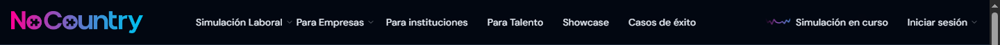
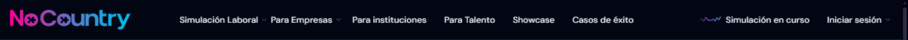
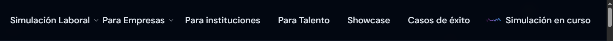
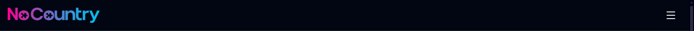
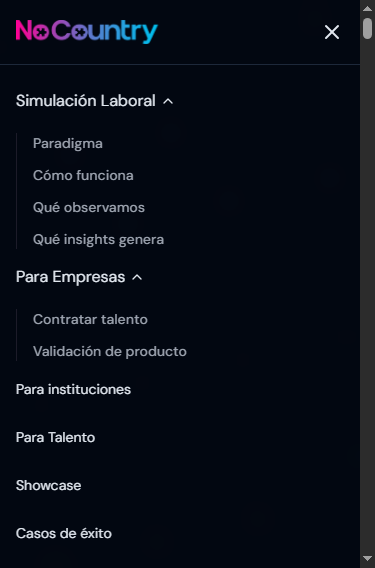
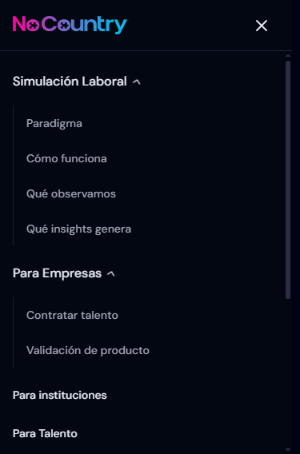

# Chrome oficial: propuesta de mejoras desde Testimonios

**Revisión:** 23 de octubre de 2026. **Alcance implementado:** adaptación al scroll del documento, navbar y footer institucional. La etapa 3 no sustituye la revisión humana ni inicia la etapa 4 de QA integral.

Este documento propone alternativas al equipo de la [web oficial](https://www.nocountry.tech/). Busca conservar su identidad visual y aportar evidencia reproducible. No es una auditoría completa del sitio ni implica que todas las soluciones deban trasladarse automáticamente: la navegación modal, el layout y las necesidades de cada aplicación requieren evaluación propia.

## Referencia visual preservada

Se reutiliza el logo existente y DM Sans. La fila mide 64px más 1px de borde, con fondo `rgba(3, 7, 17, 0.8)`, blur de 12px y padding horizontal de 16px. Los enlaces desktop conservan 14px/20px con fuente raíz de 16px, color `#e1e7ef`, hover rosa y desplegables oscuros. Los neutros específicos se aíslan en un CSS Module; no se remapean tokens globales ni se copia CSS compilado del sitio oficial.

Referencia, 1440px:

Testimonios, mismas condiciones:

## Problemas reproducidos y alternativas implementadas

| Condición observada en la referencia | Alternativa en Testimonios | Beneficio y diferencia deliberada |
| --- | --- | --- |
| A 1440px, cambiando la fuente raíz a 24px, el documento mide 1583px de ancho frente a 1425px disponibles; el header crece a 97px. | Se mide el ancho real del logo, navegación, acciones y gaps. Desde 1280px se habilita desktop solo si todo cabe; en caso contrario aparece el botón de navegación compacta. | Mantiene el tamaño del texto y evita recortar enlaces. A 1280px y fuente normal puede mostrarse compacto; no se comprime la tipografía para forzar la fila. |
| A 375×568px, con los tres grupos móviles abiertos, el header inline mide 730px. Su posición sticky deja enlaces fuera del viewport al desplazar la página. | Diálogo nativo limitado a `100dvh`, toolbar estable y navegación vertical con scroll interno. | Todos los destinos siguen disponibles en pantallas bajas. Es una navegación modal sobre el contenido, a diferencia de la expansión inline de la referencia. |
| El botón móvil del HTML de referencia se identifica como “Toggle menu”, sin `aria-expanded` ni `aria-controls`. | Botón “Abrir navegación” con estado, asociación al diálogo y nombre accesible. Cerrar y Escape devuelven el foco. | Comunica propósito y estado; no cambia el icono visible de la referencia. |
| Los desplegables de la referencia utilizan roles `menu`/`menuitem`. | Disclosure Navigation: botones con estado y listas de enlaces; Tab/Shift+Tab nativos, Enter/Espacio y Escape. | El contrato de teclado corresponde a navegación web. No se afirma que los roles aislados demuestren por sí mismos un incumplimiento del sitio oficial. |

La primera medición es una **simulación mediante `document.documentElement.style.fontSize`**, no una prueba de las preferencias reales de fuente ni de zoom del navegador. Esas comprobaciones manuales permanecen pendientes.

Fuente raíz de 24px en la referencia:

Testimonios en las mismas condiciones:

Menú oficial con tres grupos abiertos a 375×568px:

Testimonios, mismos grupos y viewport:

## Decisiones propias de Testimonios

- El header y el layout permanecen en servidor; `SiteNavigation` concentra los eventos y el estado cliente. El catálogo tipado evita duplicar destinos entre desktop y móvil.
- Los destinos institucionales son absolutos. Los portales mantienen `talent.nocountry.tech` y `companies.nocountry.tech`; no se reescriben sus rutas de inicio. Los CTA y enlaces locales continúan usando `next/link`.
- Se verificaron los 14 destinos del catálogo mediante HEAD: todos terminan en HTTP 200; los dos portales redirigen a sus entradas actuales. `#live` existe en el HTML oficial. No se incorporan placeholders ni fragmentos sin verificar.
- Se conserva un solo grupo abierto en desktop. Clic exterior y salida de foco cierran sin robarlo; Escape devuelve el foco al disparador. Los paneles cerrados quedan inertes y fuera del árbol accesible durante su salida.
- Los controles y enlaces de los desplegables tienen un mínimo de 44px. Esto puede aumentar moderadamente la altura de los popups frente a la referencia. El de sesión se alinea al borde derecho y los paneles limitan su altura disponible.
- El diálogo móvil reutiliza el bloqueo de scroll y el gutter estable de la etapa anterior. Una guarda local envuelve Tab/Shift+Tab: Chrome permitía alcanzar el documento al completar el recorrido de un diálogo nativo sin esa guarda. Esta es una necesidad de la variante modal de Testimonios, no un defecto atribuido al menú inline oficial.
- Al cambiar de modo se cierra el contenido incompatible y se conserva el foco en un control visible, sin remontar el formulario. La altura real del header actualiza el offset global; `focusAndReveal()` sigue midiéndola directamente.
- El indicador de simulación es decorativo y enlaza a `/#live`; no anuncia datos dinámicos ni consulta un servicio. El trazo y las transiciones se detienen con `prefers-reduced-motion`.

## Evidencia de QA y límites

Pruebas en Chrome headless 156 sobre Windows y el build de producción de localhost, con perfil temporal limpio y bloqueo de solicitudes distintas de GET/HEAD. No se enviaron formularios ni se alteraron registros. La ejecución final completó 228 comprobaciones del navbar y 20 de integración sin fallos ni excepciones de JavaScript en el navegador. Una comprobación adicional de las tres rutas registró cero errores de consola y de hidratación.

- Matriz del navbar: 320, 375, 768, 1024, 1280, 1440, 1536 y 1920px con fuentes raíz de 16, 20, 24 y 32px.
- A 1440px con fuente raíz de 24px, Testimonios conserva 1430px de ancho disponible y de documento, header de 65px y modo compacto. A 375×568px con todos los grupos abiertos, el diálogo mide 568px: su navegación desplaza 812px de contenido dentro de 504px, sin overflow horizontal (355px disponibles y de contenido).
- Geometría del header sticky, ausencia de overflow horizontal del navbar, cambio automático a compacto, bloqueo/restauración del documento y scroll local del diálogo.
- Apertura/cierre de los tres grupos desktop, exclusividad, clic exterior, salida de foco, Enter/Espacio, Tab/Shift+Tab, Escape y retorno de foco.
- Diálogo a 320×320px con fuente raíz de 32px y todos los grupos abiertos; recorrido completo de teclado y cambio a desktop con el modal abierto.
- IDs ARIA y SVG únicos, controles asociados, paneles inertes, foco visible y movimiento reducido.
- Regresión de búsqueda, filtros, contador, estados vacíos y navegación del carrusel. En `/enviar`, cinco pasos, errores, altura real del header, datos conservados y recorte. En la ficha, fotografía ampliable, Escape, foco y posición. Los envíos reales quedan excluidos.
- TypeScript, ESLint, build y `git diff --check` finalizaron correctamente. ESLint general conserva el warning conocido de `landing-contratar`, ajeno a este cambio.

Las capturas muestran solo el navbar para separar la comparación de las diferencias de contenido entre sitios. Las comprobaciones geométricas y de teclado no sustituyen la aprobación visual humana ni certifican accesibilidad completa. Quedan pendientes zoom real, preferencias de fuente del navegador, lectores de pantalla, Safari/iOS y Firefox.

El servidor de Next registró `The destination stream closed early` en el contexto de las sesiones de QA que se cierran e interrumpen peticiones. El mismo mensaje se observó en la etapa de scroll anterior al navbar; no se atribuye a esta implementación. Conviene observar también el uso habitual en localhost sin esos cierres automatizados.

## Footer institucional — etapa 3

Se conserva la composición de la [referencia oficial](https://www.nocountry.tech/): fondo `#090a15`, contenedor de hasta 1280px a fuente normal, espaciados, columnas, descripción institucional, logo PNG, trazados sociales, luces y geometría decorativa. `SiteFooter` permanece en servidor y reutiliza el catálogo tipado del navbar. No introduce dependencias, estado ni consultas.

### Observaciones verificadas y propuestas

| Evidencia en la referencia | Implementación en Testimonios | Alcance y beneficio |
| --- | --- | --- |
| “Simulaciones abiertas” apunta a `/#proxima-simulacion`, pero ese ID no existe en el documento consultado. “Modelo de validación” y los dos legales apuntan a `#`. `#faq` sí existe. | Se conservan los cuatro textos pendientes, sin enlaces, eventos ni foco artificial. Los demás destinos son absolutos y reutilizan el catálogo. | Evita aparentar una navegación disponible. Las URLs pendientes requieren confirmación del equipo, no una sustitución por páginas relacionadas. |
| Copyright de 12px, color `#71717a` y fondo base `#090a15`: contraste calculado de 4,08:1, inferior a 4,5:1 para texto normal. | Copyright y textos secundarios usan `#a1a1aa`. | Las luces y figuras se mantienen. El peor fondo de las capturas de Testimonios a 375 y 1440px da un límite inferior de 6,04:1 para esos textos. Componer ambas luces al 10% y ambos trazos blancos al 5%, simultáneamente y a opacidad máxima, mantiene al menos 4,85:1. Este último valor es una cota conservadora calculada, no una muestra del copyright oficial. |
| Los tres enlaces sociales miden 40×40px a fuente raíz de 16px. | Controles de 44×44px, nombres con aviso de nueva pestaña y foco visible. | Aumenta el área táctil solicitada. La medida original de 40px no implica por sí sola un incumplimiento de WCAG. |
| A 320px y fuente raíz simulada de 32px, la fila legal sin wrapping mide 271,156px dentro de un contenedor de 241px. Sus textos todavía quedan dentro del footer: no se afirma un recorte del texto en ese caso. | Fila legal con wrapping; grilla con tracks que ceden columnas cuando crece el texto. | Mantiene el contenido dentro de su columna sin reducir la fuente ni fijar alturas. La matriz de Testimonios no presentó desbordamientos. |

Los fondos se midieron en capturas PNG sin el contenido frontal, conservando las luces y figuras en la sesión de prueba. Se decodificaron los píxeles y se tomó la mayor luminancia del fondo como límite conservador para el contraste de los textos. El fondo de los botones sociales se trata aparte del texto secundario, y sus iconos mantienen contraste suficiente con su superficie.

### Diferencias visuales deliberadas

- Logo de 237,484×40px en ambos sitios a 375 y 1440px. El enlace local tiene un mínimo de 44px de alto; el recurso PNG no se modifica.
- Footer local 8px más alto a fuente normal: 897,5px frente a 889,5px a 375px, y 406px frente a 398px a 1440px. Corresponde al enlace de marca y a los controles sociales de 44px.
- Copyright más claro y destinos pendientes sin hover ni interacción. Se conservan sus textos, ubicación y tipografía.
- A fuente ampliada, la grilla puede tener menos columnas y los legales pueden pasar de fila. A fuente normal se mantiene la distribución oficial.
- Las capturas tienen 5px de diferencia en el ancho disponible por los scrollbars preexistentes de ambas aplicaciones. No se modifica el scrollbar para esta etapa.

### Capturas comparativas

Capturadas en Chrome 156, viewport de 900px de alto, DPR 1 y fuente raíz de 16px. Se oculta temporalmente el header solo durante la captura del footer para evitar su superposición sticky; no se cambia su implementación. Los enlaces de los sitios externos no se activaron.

| Ancho | Referencia | Testimonios |
| --- | --- | --- |
| 375px | [Footer oficial](./assets/official-chrome/footer-reference-375.png) | [Footer de Testimonios](./assets/official-chrome/footer-testimonios-375.png) |
| 1440px | [Footer oficial](./assets/official-chrome/footer-reference-1440.png) | [Footer de Testimonios](./assets/official-chrome/footer-testimonios-1440.png) |

[Testimonios a 320px y fuente raíz de 32px](./assets/official-chrome/footer-testimonios-320-text32.png).

### QA realizado y límites de la evidencia

- Build de producción, Chrome headless y perfil limpio. Las solicitudes del navegador distintas de GET/HEAD se bloquearon; no se enviaron formularios ni se modificaron registros.
- 24 combinaciones: 320, 375, 768, 1024, 1280 y 1440px × fuentes raíz simuladas de 16, 20, 24 y 32px. Sin desbordamiento horizontal de página, footer ni sus textos.
- Tab y Shift+Tab por los diez enlaces del footer, foco de 2px visible a 320×320px y fuente de 32px, nombres sociales, destinos HTTPS, nuevas pestañas protegidas y tres grupos de navegación identificados.
- Movimiento reducido, menú móvil abierto sobre el footer a 375×320px y fuente de 24px, grupos expandibles, bloqueo del documento, Escape, foco y restauración de posición. Orientación horizontal a 768×375px con fuente de 32px.
- Las tres rutas conservan el footer después de su contenido y el scroll del documento. Se recorrieron los cinco pasos del formulario con archivos locales: error de avatar y foco bajo el header, recortes, resumen y persistencia al retroceder, sin enviar.
- Ficha publicada: fotografía ampliable, Escape, bloqueo/restauración de scroll y retorno de foco. La ruta inexistente conserva el footer.
- Éxito del formulario y error de `PageShell`: renderizados aislados de los componentes reales para comprobar posición y crecimiento flexible del layout. No representan un envío real ni un fallo provocado del backend.
- Cero errores de JavaScript en las ejecuciones finales del footer y de integración. TypeScript, ESLint general y build correctos; solo permanece el warning preexistente de `landing-contratar`.

El servidor volvió a registrar `The destination stream closed early` durante estas sesiones de QA. Es el mismo mensaje documentado en las etapas anteriores; no apareció como error de JavaScript del navegador ni se atribuye al footer. Queda observar el uso manual habitual sin cierres automatizados de páginas.

La simulación de fuente raíz y las capturas no sustituyen zoom real, preferencias de fuente, lectores de pantalla o pruebas en otros navegadores. La revisión visual humana y esas comprobaciones permanecen pendientes. Esta propuesta registra alternativas para evaluar con el equipo oficial; no presupone que deban trasladarse automáticamente a su aplicación.
